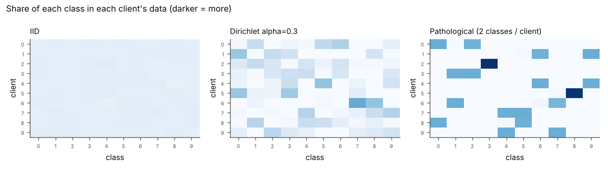
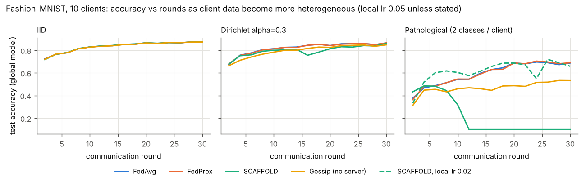
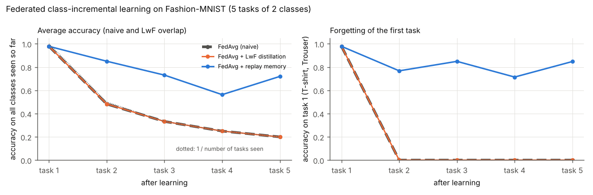

# Federated learning under extreme non-IID data, and federated continual learning


  

**Key result:** when each client sees only 2 classes out of 10, FedAvg loses ~19 accuracy points and some classes
are never predicted again (worst class 0 %). SCAFFOLD is the only method that keeps every class alive (worst class
38 % vs ≤ 2 %), at the price of instability and twice the communication.

**Federated learning:** several clients (aircraft, sensors, hospitals, phones…) train one shared model
**without sending their data**, only model updates. The hard case is when clients' data are very different:
in the *pathological non-IID* setting each client only sees 2 classes out of 10. This project studies:

1. **Heterogeneity:** how FedAvg, FedProx, SCAFFOLD and a serverless *gossip* protocol behave from IID to pathological data.
2. **Continual learning:** what happens when new classes appear over time (catastrophic forgetting), and two mitigations.

All algorithms are **implemented from scratch** in PyTorch (`fedlab/algorithms.py`), on flat parameter vectors so
that every equation of the papers is visible in the code.

| Algorithm | Idea | Paper |
|---|---|---|
| FedAvg | local SGD, then weighted average of the models | McMahan et al., 2017 |
| FedProx | + proximal term μ/2‖w − w_global‖² against client drift | Li et al., 2020 |
| SCAFFOLD | control variates c, cᵢ correct each local gradient (g − cᵢ + c) | Karimireddy et al., 2020 |
| Gossip (decentralised SGD) | no server: each client averages with its 2 neighbours on a ring, a **consensus** protocol | Lian et al., 2017 |

## Setup

Fashion-MNIST, 20 000 training images split over **10 clients**, small CNN (52 k parameters), 30 communication
rounds, 1 local epoch per round, SGD with batch 32, all clients participate in every round. Evaluation on the
10 000 official test images. Three partitions (each row of the right panel is a client):



## Part A: from IID to pathological non-IID

Test accuracy after 30 rounds (in brackets: accuracy of the **worst class**):

| Algorithm (local lr 0.05) | IID | Dirichlet α = 0.3 | Pathological, 2 classes / client | Data sent per run |
|---|---:|---:|---:|---:|
| FedAvg | 87.4 % (61.8) | 86.4 % (50.7) | 68.7 % (0.0) | 125 MB |
| FedProx (μ = 0.01) | 87.4 % (62.2) | 86.5 % (50.8) | 68.9 % (0.0) | 125 MB |
| SCAFFOLD | 87.4 % (60.0) | 86.0 % (50.0) | **diverged** (10 %) | 250 MB |
| Gossip on a ring (no server) | 87.3 % (59.8) | 84.8 % (33.6) | 53.2 % (0.0) | 125 MB |
| *FedAvg, local lr 0.02* | – | – | 64.0 % (1.8) | 125 MB |
| *SCAFFOLD, local lr 0.02* | – | – | 65.8 % (**38.4**) | 250 MB |



**What the results show**

* **Label skew costs ~19 accuracy points** (87 % → 69 %) and, worse, some classes are never predicted any more
  (worst-class accuracy 0 %): the averaged model is pulled in incompatible directions by the clients.
* **FedProx** changes almost nothing here: with μ = 0.01 the proximal term is small compared to the gradient.
* **SCAFFOLD is the only method that keeps every class alive** (worst class 38 % vs ≤ 2 % for FedAvg at the same
  learning rate), but it is **unstable**: with the shared learning rate 0.05 it diverged after ~10 rounds on the
  pathological split. Its control variates are estimated from the previous round; when clients drift a lot,
  the correction itself becomes too large. It also doubles the communication (model + control variate).
* **Gossip** removes the central server (no single point of failure), but on a ring information spreads slowly:
  it matches FedAvg on IID data and falls behind as heterogeneity grows (53 % vs 69 %). A better-connected graph
  would mix faster (spectral gap of the mixing matrix).

## Part B: federated continual learning (catastrophic forgetting)

Class-incremental scenario: 5 tasks of 2 classes (T-shirt/Trouser, then Pullover/Dress, …). During each task the 10
clients only hold the 2 current classes (Dirichlet α = 0.5 between clients), 8 FedAvg rounds per task. One single
10-class model must still recognise all previous classes.

| Method | Final accuracy on the 10 classes | Mean forgetting of past tasks |
|---|---:|---:|
| FedAvg (naive) | 20.0 % | 98.5 points |
| FedAvg + LwF distillation (λ = 1, T = 2) | 19.9 % | 98.5 points |
| **FedAvg + replay memory** (20 images per class per client) | **72.0 %** | **31.5 points** |



* Without protection the model **only knows the last task**: accuracy is exactly 1 / (number of tasks).
* **Learning without Forgetting does not help in this class-incremental setting**: distilling the old-class outputs
  does not stop the new classes from dominating the shared output layer. This matches the literature
  (van de Ven et al., 2022).
* A **small replay memory** (at most 10 % of what each client sees, kept locally, never shared) recovers most of the knowledge.
  Trade-off: storing samples on the client, which may be restricted in some applications.

## Run it

```bash
pip install -r requirements.txt
python -m pytest -q tests                  # 5 tests on synthetic data
python run_experiments.py --part A         # ~35 min on a laptop CPU (12 runs, resumable)
python run_experiments.py --part B         # ~6 min
python run_experiments.py --part A --schemes path2 --algos scaffold@0.02 fedavg@0.02
```
All numbers are written to `results/*.json`.

## Limits and next steps

One seed per configuration (differences below ~1 point are not significant), a small CNN and Fashion-MNIST.
Next: several seeds, partial participation, prototype-based methods (FedProto) and server-side distillation,
generative replay to avoid storing raw samples, and the spectral gap of the gossip graph vs convergence speed.

## References

* McMahan et al., *Communication-Efficient Learning of Deep Networks from Decentralized Data*, AISTATS 2017.
* Li et al., *Federated Optimization in Heterogeneous Networks* (FedProx), MLSys 2020.
* Karimireddy et al., *SCAFFOLD: Stochastic Controlled Averaging for Federated Learning*, ICML 2020.
* Lian et al., *Can Decentralized Algorithms Outperform Centralized Algorithms?*, NeurIPS 2017.
* Li & Hoiem, *Learning without Forgetting*, TPAMI 2017.
* van de Ven, Tuytelaars & Tolias, *Three types of incremental learning*, Nature Machine Intelligence 2022.
* Xiao, Rasul & Vollgraf, *Fashion-MNIST*, 2017.

---
Author: **Gaya Lahouazi**, M2 AI2D (Sorbonne Université). Links with the COCOMA course (multi-agent
coordination and consensus).
